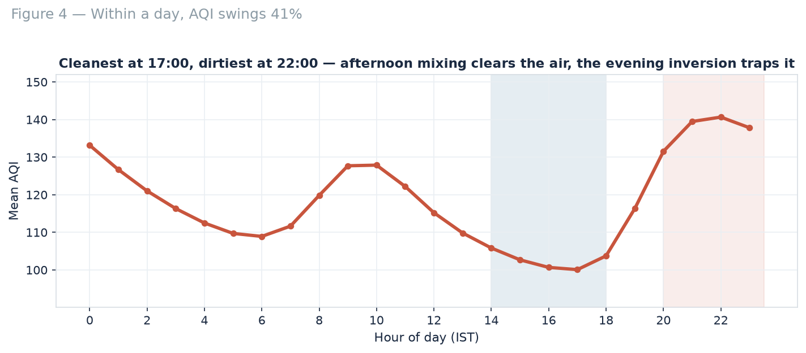
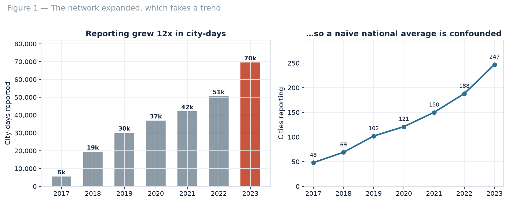

# India's air, 2017–2023 — seven years of CPCB monitoring

A data-science case study on **254,138 city-days** of official Indian air-quality data: what actually changed, what drives it, and how far a forecast can be trusted.

**The short version:** air quality improved **17.9%** on a constant panel of 12 cities, but the seasonal cycle moves **2.6×** more than that, and within a single day AQI swings **41%**. A ridge model beats a persistence baseline by only **8.8%** — which is the honest ceiling without pollutant and weather data.

---

## Key findings

| Question | Answer |
|---|---|
| Is the air getting better? | Yes, modestly: mean AQI fell **17.9%** from 2017 to 2023 on a constant 12-city panel. 9 of the 12 improved. |
| How bad is it still? | **16.8%** of city-days are Poor or worse. Only **14.6%** qualify as Good. |
| What dominates the signal? | Season. November runs **2.56×** the July monsoon trough — larger than seven years of trend. |
| Is there a daily rhythm? | Yes: cleanest at **17:00**, dirtiest at **22:00**, a **41%** swing driven by boundary-layer mixing. |
| Can tomorrow be forecast? | Modestly. Ridge beats "tomorrow = today" by **8.8%** MAE; gradient boosting does no better. |

<p align="center">
  
</p>

---

## The trap this analysis is built around

The CPCB network grew from **48 reporting cities in 2017 to 247 in 2023** — a twelve-fold expansion. A national average taken over all available rows therefore measures who was measuring, not what the air was doing.

Every trend here is computed on a **constant panel**: cities with at least 180 reporting days in *every* year of the window. A second, denser panel (52 cities, 2019–2023) is used as a robustness check, and agrees on the direction.

<p align="center">
  
</p>

---

## What's in this repo

```
├── india_air_quality_analysis.ipynb      Executed notebook — single source of truth
├── data/
│   └── cpcb-aqi.parquet                  Raw CPCB station-day data, 562,878 rows
├── figures/                              Eight charts, 150 dpi (generated by the notebook)
├── reports/
│   ├── india_air_quality_report.pdf      Seven-page written report
│   ├── india_air_quality_deck.html       Thirteen-slide deck (plain-work design)
│   └── india_air_quality_deck_meridian.html  Same deck, Meridian design
├── metrics_air.json                      Every number quoted in the report and decks
└── requirements.txt
```

The notebook streams the raw parquet, applies the cleaning rules, builds all eight figures, trains and evaluates four forecast candidates, and writes `metrics_air.json` — so **no number in any deliverable was typed by hand**.

---

## Method, in order

1. **Audit** — 562,878 station-days × 24 hourly AQI readings, 2017–2023.
2. **Cleaning** — keep a station-day only with ≥18 of 24 hourly values (CPCB's 75% rule); drop AQI outside (0, 1000]; collapse monitors to one row per city-day using the **median** across stations, since a city can carry up to 39 monitors.
3. **Panel construction** — the twelve cities with 180+ reporting days in every year, plus a 52-city dense panel as a check.
4. **Analysis** — seven-year trend, monthly seasonality, hourly diurnal cycle, city ranking, CPCB category distribution, and the April–June 2020 lockdown window.
5. **Forecasting** — next-day AQI for 12 pooled cities, features being AQI lags (1/2/3/7 days), 7- and 30-day rolling means, month, weekday and a smooth day-of-year term. **Time-based split**: train to end-2022, test 2023.

| Model | MAE | R² | Within 50 |
|---|---|---|---|
| **Ridge regression** | **28.4** | **0.779** | **83%** |
| Gradient boosting | 28.6 | 0.769 | 82% |
| Persistence (tomorrow = today) | 31.2 | 0.710 | 80% |
| 7-day rolling mean | 31.2 | 0.737 | 80% |

---

## Run it

```bash
git clone https://github.com/nx-manoj/Machine-learning-projects.git
cd Machine-learning-projects/Air-Quality-India
pip install -r requirements.txt
jupyter notebook india_air_quality_analysis.ipynb
```

Runtime is about a minute on a single CPU. Random seed 42; scikit-learn 1.9, pandas 3.1. The notebook processes the parquet in batches to stay inside a 1.5 GB memory limit — worth knowing if you adapt it.

---

## Limitations

- **AQI is an index, not a measurement.** It reports the worst sub-index across pollutants, so it hides which pollutant drove a given day; this dataset carries no pollutant breakdown.
- **One number per city per day.** A median across monitors erases the intra-urban variation that determines personal exposure.
- **Station siting changes.** A relocated or recalibrated monitor produces exactly the signature Varanasi's −65% fall shows — treat it as a hypothesis, not a victory.
- **2020 is a structural break.** Models trained across it learn a level that never recurs.
- **No meteorology.** Wind, mixing height and rainfall explain much of the residual variance; without them the forecast ceiling stays low.

### Next steps

- Join pollutant-level data (PM2.5, PM10, NO2) to identify what drives the index.
- Add meteorology and satellite fire counts — the features most likely to beat persistence by more than 9%.
- Model at station level with a hierarchical structure rather than collapsing to city medians.
- Test a 3-day horizon, where persistence decays and a real model earns its keep.

---

## Data

CPCB AQI Repository (station-level, 15-minute data aggregated to daily), mirrored as a single parquet at [github.com/Vonter/india-cpcb-aqi](https://github.com/Vonter/india-cpcb-aqi). The parquet in `data/` is that mirror, unmodified.

Code is MIT licensed; the dataset keeps its original terms.
