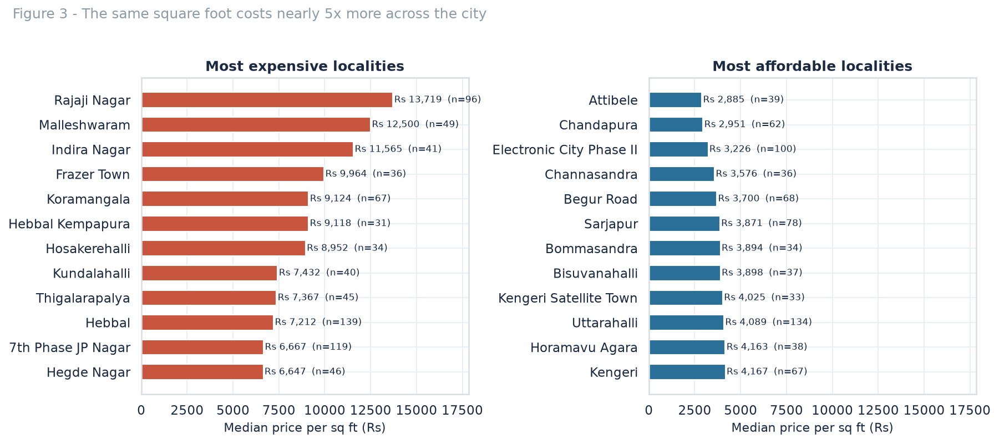
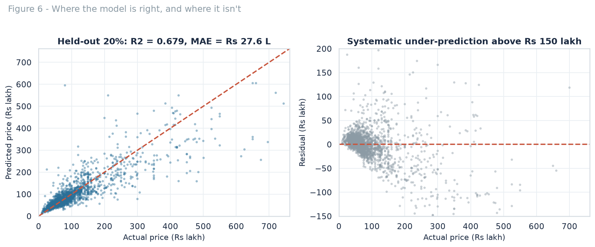

# Bengaluru residential prices — what actually drives the number on the board

A data-science case study on **13,320 Bengaluru property listings**: data cleaning, exploratory analysis, and a price model that is honest about where it fails.

**The short version:** built-up area explains most of an asking price, locality sets the rate (a **4.8×** spread across one city), and a gradient-boosted model prices a held-out listing to a median error of **17.7%** — useful as a sanity check on a quote, not as a valuation.

---

## Key findings

| Question | Answer |
|---|---|
| What explains asking price? | Built-up area, above everything else (r = 0.74) |
| How much does location matter? | The same square foot ranges from **₹2,885** (Attibele) to **₹13,719** (Rajaji Nagar) — a **4.8×** spread |
| What does an extra bedroom cost? | A 3BHK asks **51%** more than a 2BHK in the same locality but offers only **37%** more floor area — about **10%** is configuration premium |
| Can we predict price? | Yes, to **₹27.6 lakh MAE** on held-out data (R² 0.68), against ₹56.0 lakh for a naive median guess |
| Where does it fail? | Above roughly ₹150 lakh it systematically under-predicts |

<p align="center">
  
</p>

---

## What's in this repo

```
├── bengaluru_housing_analysis.ipynb   Executed notebook — the single source of truth
├── data/
│   └── Bengaluru_House_Data.csv       Raw listings, 13,320 rows × 9 columns
├── figures/                           Seven charts, 150 dpi (generated by the notebook)
├── reports/
│   ├── bengaluru_housing_report.pdf   Six-page written report
│   └── bengaluru_housing_deck.html    Eleven-slide deck (open in a browser, ←/→ to navigate)
├── metrics.json                       Every number quoted in the report and deck
└── requirements.txt
```

The notebook writes `figures/` and `metrics.json`; the report and deck were built from those outputs, so **no number in any deliverable was typed by hand**.

---

## The analysis, in order

1. **Audit** — 9 columns, 1,305 distinct locality spellings, `society` 41% missing.
2. **Cleaning** — 1,897 rows discarded (14.2%), each removal counted:
   - `total_sqft` stored as text, parsed out of ranges (`"1000 - 1500"`) and six units (sq m, yards, acres, cents, guntha, perch)
   - impossible area-per-bedroom (< 300 sq ft), more bathrooms than rooms allow, area outside 300–10,000 sq ft
   - price/sq ft beyond 3 standard deviations of its own locality
   - 875 exact duplicates
3. **EDA** — log-price distribution, configuration, locality premium, correlations.
4. **Modelling** — target is `log(price)`; features are area, bedrooms, bathrooms, balconies, area per bedroom, ready-to-move, area type and locality group. All preprocessing sits **inside a `Pipeline`**, so nothing leaks across folds. Five models compared on 5-fold CV; the 20% holdout was touched once.
5. **Diagnostics** — residuals, error bands, permutation importance, and the luxury tail where the model breaks.

| Model | CV R² (log) | MAE | RMSE |
|---|---|---|---|
| **Hist gradient boosting** | **0.791** | **₹30.6 L** | **₹82.7 L** |
| Random forest | 0.785 | ₹32.0 L | ₹94.6 L |
| Gradient boosting | 0.775 | ₹32.1 L | ₹86.3 L |
| Linear regression | 0.723 | ₹39.2 L | ₹158.6 L |
| Ridge regression | 0.723 | ₹39.3 L | ₹160.3 L |

<p align="center">
  
</p>

---

## Run it

```bash
git clone https://github.com/nx-manoj/Machine-learning-projects.git
cd Machine-learning-projects/Bengaluru-Housing-Prices
pip install -r requirements.txt
jupyter notebook bengaluru_housing_analysis.ipynb
```

Runtime is about three minutes on a single CPU. Random seed 42 throughout; scikit-learn 1.9, pandas 3.1.

---

## Limitations

These are properties of the data, not of the modelling approach:

- **Asking prices, not transactions.** Listed prices in India sit above the eventual deal; this estimates the quote, not the cheque.
- **One snapshot.** Availability dates cluster in 2018, so there is no time dimension and no market cycle.
- **No builder or amenity signal.** `society` is 41% missing — the strongest quality variable a human valuer uses is absent.
- **Locality labels are merged.** 1,305 raw spellings collapsed to 227 groups; some distinct neighbourhoods sit in an `Other` bucket.
- **The luxury tail is unreliable.** Above ₹150 lakh the model under-predicts; tree ensembles cannot extrapolate past their training range.

Next steps that would actually help: listing dates, distance to metro and tech parks, floor number and building age, quantile regression for a price range, and validation against registered transaction data (Kaveri/IGR).

---

## Data

Public Bengaluru house-price listings dataset (13,320 rows × 9 columns), widely mirrored from its original Kaggle release. All prices are in **₹ lakh**, and all analysis is in Indian numbering conventions.

Code is MIT licensed; the dataset keeps its original terms.
